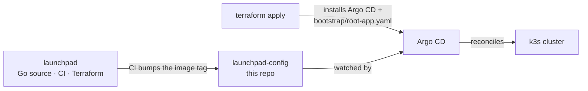

# launchpad-config

GitOps desired state for [Launchpad](https://github.com/SihanUdayaratna03/launchpad):
every pull request gets its own isolated, quota-limited, time-limited preview
environment on Kubernetes.

This repository holds **what runs in the cluster**: Helm charts, Argo CD
applications, admission policies and monitoring. The Go source, CI pipeline,
Terraform and the architecture write-up live in
[`launchpad`](https://github.com/SihanUdayaratna03/launchpad).

Nothing is applied by hand. Argo CD watches this repository and reconciles the
cluster against it. CI in `launchpad` never touches the cluster; it only bumps an
image tag here.

---

## How the two repositories fit together



`bootstrap/root-app.yaml` is the only thing Terraform hands to Argo CD. It points at
`argocd/`, and everything else comes up from there (App of Apps).

---

## Layout

    bootstrap/
      root-app.yaml                  App of Apps entry point, applied once at bootstrap
    argocd/                          one Argo CD Application per platform component
      controller.yaml                webhook controller + reaper (charts/controller)
      previews.yaml                  ApplicationSet that creates one app per open PR
      kyverno.yaml                   Kyverno itself
      kyverno-policies.yaml          the policies in policies/
      prometheus.yaml                Prometheus
      grafana.yaml                   Grafana
      monitoring-dashboards.yaml     dashboards in monitoring/dashboards/
    charts/
      controller/                    Deployment, Ingress, RBAC and the reaper CronJob
      preview/                       what each PR gets: Deployment, Service, Ingress,
                                     ResourceQuota, NetworkPolicy
    policies/                        Kyverno admission policies for preview namespaces
    monitoring/
      prometheus-values.yaml         scrape config and the alert rules
      grafana-values.yaml            datasource and dashboard sidecar
      dashboards/                    the Launchpad Grafana dashboard
    apps/demo/                       demo workload manifests
    hack/
      local-test.sh                  local test run
      local-monitoring-test.sh       local k3d check that Prometheus scrapes the controller

---

## The preview chart

`charts/preview` is what the ApplicationSet renders once per pull request, into a
namespace called `preview-pr-<N>`:

| Template | Purpose |
|---|---|
| `deployment.yaml` | The workload, pinned to an image tag (the commit SHA) |
| `service.yaml` | Cluster-internal service |
| `ingress.yaml` | Host `pr-<N>.<ip-with-dashes>.nip.io` through Traefik |
| `quota.yaml` | `ResourceQuota`: caps pods, CPU and memory per preview |
| `networkpolicy.yaml` | Default-deny between namespaces |

## The controller chart

`charts/controller` deploys the two Go binaries from the `launchpad` image:

| Template | Purpose |
|---|---|
| `deployment.yaml` | The webhook controller, annotated for Prometheus scraping |
| `ingress.yaml` | Publishes `/webhook` through Traefik (`/metrics` is not published) |
| `rbac.yaml` | Separate ServiceAccounts for the controller and the reaper, each with only the verbs it needs |
| `rbac-openchoreo.yaml` | The same, for the OpenChoreo backend. Rendered only when `backend: openchoreo` |
| `reaper.yaml` | CronJob, every 10 minutes (`reaper.schedule` in `values.yaml`) |

### Choosing a backend

Launchpad's controller and reaper can drive either Argo CD or
[OpenChoreo](https://github.com/SihanUdayaratna03/launchpad#running-on-openchoreo). `backend`
in `values.yaml` picks which, and it changes what this chart renders:

| `backend` | What it renders |
|---|---|
| `argocd` (default) | A Role letting the controller `get` and `patch` `applicationsets`, and the reaper's namespace permissions. This is what runs on AWS |
| `openchoreo` | Those are left out, and `rbac-openchoreo.yaml` takes their place: the controller may `get`, `create`, `patch` and `delete` `projects`, `projectreleasebindings`, `components` and `workloads`; the reaper may only `list` and `delete` `projects` |

Neither mode holds a permission it cannot use, so switching the backend takes the other
one's access away rather than adding to it. The settings live under `openchoreo`:

```yaml
backend: openchoreo

openchoreo:
  namespace: default
  environment: development
  image: sihanudayaratna/launchpad-demo
  host: development-default.openchoreoapis.localhost:19080
```

Both the Deployment and the reaper CronJob read them as environment variables. Rendered with
the default values, the chart produces exactly what it produced before the switch existed:

```bash
helm template charts/controller                            # no OpenChoreo objects
helm template charts/controller --set backend=openchoreo   # no Argo CD permissions
```

## Policies

Kyverno enforces these on preview namespaces:

| Policy | Rule |
|---|---|
| `preview-allowed-images` | Only images from allowed registries |
| `preview-disallow-latest-tag` | No `:latest`; images must be pinned |
| `preview-disallow-privileged` | No privileged containers |
| `preview-require-non-root` | Containers must run as non-root |
| `preview-require-resources` | Requests and limits must be set |

## Monitoring

Prometheus scrapes the controller's `/metrics`. The alert rules (controller down,
webhook errors, webhook rejections, comment failures, too many previews, preview not
ready) are in `monitoring/prometheus-values.yaml`; the dashboard is
`monitoring/dashboards/launchpad-dashboard.yaml`. Open Grafana with:

```bash
kubectl -n monitoring port-forward svc/grafana 3000:80
```

---

## How a change reaches the cluster

1. A commit in `launchpad` builds and scans the image and pushes `:<sha>`.
2. CI commits the new tag to this repository.
3. Argo CD sees the change and rolls the workload.

Changes to charts, policies or monitoring in this repo go the same way: open a pull
request, merge, and Argo CD applies it.

## Secrets

Secrets are not stored here. Two are created by hand in the `argocd` namespace on
each cluster: `launchpad-webhook` (webhook HMAC secret) and `launchpad-github`
(token used for PR comments and checking whether a PR is closed). See
[Run it on AWS](https://github.com/SihanUdayaratna03/launchpad#run-it-on-aws).
