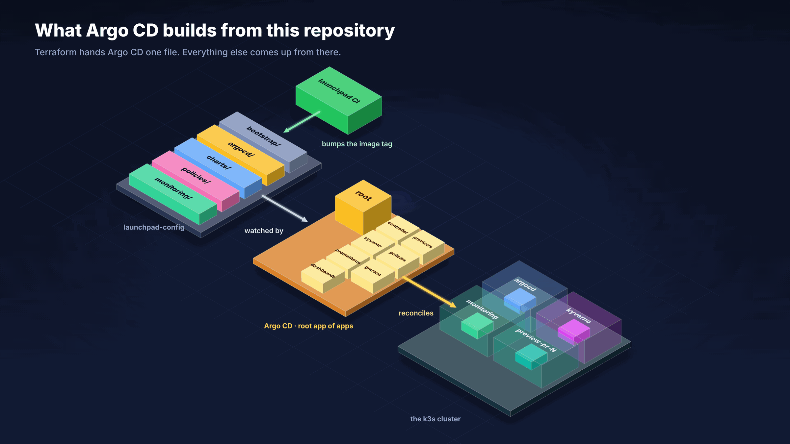
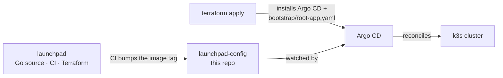
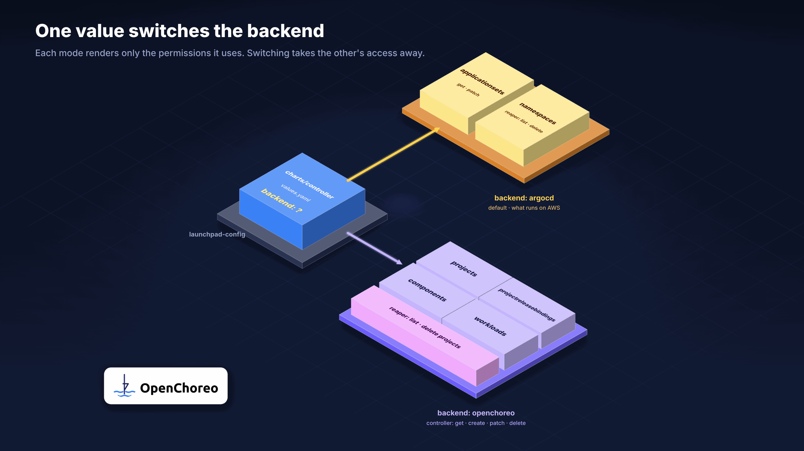

# launchpad-config

GitOps desired state for [Launchpad](https://github.com/SihanUdayaratna03/launchpad):
every pull request gets its own isolated, quota-limited, time-limited preview
environment on Kubernetes.



This repository holds **what runs in the cluster**: Helm charts, Argo CD
applications, admission policies and monitoring. The Go source, CI pipeline,
Terraform and the architecture write-up live in
[`launchpad`](https://github.com/SihanUdayaratna03/launchpad).

Nothing is applied by hand. Argo CD watches this repository and reconciles the
cluster against it. CI in `launchpad` never touches the cluster; it only bumps an
image tag here.

---

## Contents

- [How the two repositories fit together](#how-the-two-repositories-fit-together)
- [Works with OpenChoreo](#works-with-openchoreo)
- [Layout](#layout)
- [The preview chart](#the-preview-chart)
- [The controller chart](#the-controller-chart)
- [Policies](#policies)
- [Monitoring](#monitoring)
- [How a change reaches the cluster](#how-a-change-reaches-the-cluster)
- [Secrets and settings](#secrets-and-settings)

---

## How the two repositories fit together



`bootstrap/root-app.yaml` is the only thing Terraform hands to Argo CD. It points at
`argocd/`, and everything else comes up from there (App of Apps). One of those
applications, `previews`, is an ApplicationSet. Launchpad's controller adds an element
to it when a pull request opens and removes it when the PR closes, and the ApplicationSet
renders [`charts/preview`](#the-preview-chart) once per element.

---

## Works with OpenChoreo

<a href="https://openchoreo.dev"></a>

Launchpad can run its previews on [OpenChoreo](https://openchoreo.dev) instead of Argo CD,
and this repository is where that choice is made. The controller chart has a single
`backend` value:



The default, `argocd`, is what runs on AWS with Let's Encrypt certificates. With
`backend: openchoreo` the controller creates an OpenChoreo **Project** for each pull
request (a Component and a Workload inside it) and OpenChoreo builds the Deployment,
Service and Gateway API route. How that works, and the AWS run that proves it, is
written up in
[Launchpad on OpenChoreo](https://github.com/SihanUdayaratna03/launchpad#launchpad-on-openchoreo).

This repository does **not** install OpenChoreo. It carries only the part Launchpad owns:
the controller's permissions and settings for the OpenChoreo backend. OpenChoreo itself
(control plane, data plane, gateway) is installed as described in the `launchpad` README.

### Choosing a backend

| `backend` | What the controller chart renders |
|---|---|
| `argocd` (default) | A Role letting the controller `get` and `patch` `applicationsets`, and the reaper's namespace permissions |
| `openchoreo` | Those are left out. `rbac-openchoreo.yaml` takes their place: the controller may `get`, `create`, `patch` and `delete` `projects`, `projectreleasebindings`, `components` and `workloads`; the reaper may only `list` and `delete` `projects` |

Neither mode holds a permission it cannot use, so switching the backend takes the other
one's access away rather than adding to it. The OpenChoreo settings live under
`openchoreo` in `charts/controller/values.yaml`:

```yaml
backend: openchoreo

openchoreo:
  namespace: default
  environment: development
  image: sihanudayaratna/launchpad-demo
  host: development-default.openchoreoapis.localhost:19080
```

The Deployment and the reaper CronJob read them as the environment variables
`OC_NAMESPACE`, `OC_ENVIRONMENT`, `OC_IMAGE` and `OC_HOST`, next to `BACKEND` itself.
Rendered with the default values, the chart produces exactly what it produced before the
switch existed:

```bash
helm template charts/controller                            # no OpenChoreo objects
helm template charts/controller --set backend=openchoreo   # no Argo CD permissions
```

---

## Layout

    bootstrap/
      root-app.yaml                  App of Apps entry point, applied once at bootstrap
    argocd/                          one Argo CD Application per platform component
      controller.yaml                webhook controller + reaper (charts/controller)
      previews.yaml                  ApplicationSet that creates one app per open PR
      kyverno.yaml                   Kyverno itself
      kyverno-policies.yaml          the policies in policies/
      prometheus.yaml                Prometheus
      grafana.yaml                   Grafana
      monitoring-dashboards.yaml     dashboards in monitoring/dashboards/
    charts/
      controller/                    Deployment, Ingress, RBAC and the reaper CronJob
      preview/                       what each PR gets: Deployment, Service, Ingress,
                                     ResourceQuota, NetworkPolicy
    policies/                        Kyverno admission policies for preview namespaces
    monitoring/
      prometheus-values.yaml         scrape config and the alert rules
      grafana-values.yaml            datasource and dashboard sidecar
      dashboards/                    the Launchpad Grafana dashboard
    apps/demo/                       demo workload manifests
    hack/
      local-test.sh                  local test run
      local-monitoring-test.sh       local k3d check that Prometheus scrapes the controller
      local-alertmanager-test.sh     local k3d check that an alert reaches Discord
    docs/                            diagrams used in this README

---

## The preview chart

`charts/preview` is what the ApplicationSet renders once per pull request, into a
namespace called `preview-pr-<N>`:

| Template | Purpose |
|---|---|
| `deployment.yaml` | The workload, pinned to an image tag (the commit SHA) |
| `service.yaml` | Cluster-internal service |
| `ingress.yaml` | The preview's host through Traefik. With `tlsResolver` set it is served over HTTPS with a Let's Encrypt certificate, otherwise over plain HTTP |
| `quota.yaml` | `ResourceQuota`: 10 pods, 1 CPU / 1 GiB requested, 2 CPU / 2 GiB limit per preview |
| `networkpolicy.yaml` | Default-deny, then only DNS and traffic from Traefik |

The ApplicationSet passes four parameters into the chart: `prNumber`, `image.tag` (the
commit SHA), `host` and `tlsResolver`. Launchpad's controller works out the host and the
resolver from `BASE_DOMAIN` and `TLS_RESOLVER`, so the chart holds no domain of its own.
With a stable DuckDNS name the host is `pr-<N>.<name>.duckdns.org`; with none it falls
back to a `nip.io` name built from the node's IP. The chart's `ttl` value is `72h`, the
lifetime the reaper enforces.

## The controller chart

`charts/controller` deploys the two Go binaries from the `launchpad` image:

| Template | Purpose |
|---|---|
| `deployment.yaml` | The webhook controller, annotated for Prometheus scraping |
| `ingress.yaml` | Publishes `/webhook` through Traefik (`/metrics` is not published) |
| `rbac.yaml` | Separate ServiceAccounts for the controller and the reaper, each with only the verbs it needs |
| `rbac-openchoreo.yaml` | The same, for the OpenChoreo backend. Rendered only when `backend: openchoreo` |
| `reaper.yaml` | CronJob, every 10 minutes (`reaper.schedule` in `values.yaml`) |

The reaper deletes previews older than `reaper.ttl` (72 hours) and any whose pull request
has closed. `reaper.dryRun` turns it into a report-only run.

## Policies

Kyverno enforces these on preview namespaces:

| Policy | Rule |
|---|---|
| `preview-allowed-images` | Only images from allowed registries |
| `preview-disallow-latest-tag` | No `:latest`; images must be pinned |
| `preview-disallow-privileged` | No privileged containers |
| `preview-require-non-root` | Containers must run as non-root |
| `preview-require-resources` | Requests and limits must be set |

These apply to the Argo CD backend. Previews created through OpenChoreo are built by
OpenChoreo's own component types into the namespaces it manages, and are not covered by
these policies.

## Monitoring

Prometheus scrapes the controller's `/metrics`. The alert rules (controller down,
webhook errors, webhook rejections, comment failures, too many previews, preview not
ready) are in `monitoring/prometheus-values.yaml`; the dashboard is
`monitoring/dashboards/launchpad-dashboard.yaml`.

Alertmanager is part of the same release and is configured in the same values file. It
groups alerts by name and severity, repeats a still-firing one every four hours, lets a
`critical` alert silence the `warning` of the same name, and sends what is left to a
Discord channel. The webhook URL is mounted from a Secret and read with
`webhook_url_file`, so it is neither in this repository nor in the ConfigMap Alertmanager
renders.

`hack/local-alertmanager-test.sh` proves the path end to end on a throwaway k3d cluster:
it installs this release, waits for `LaunchpadControllerDown` to fire on its own, and
checks that Alertmanager both received it and delivered it, by reading Alertmanager's
`alertmanager_notifications_total{integration="discord"}` and its failure counter.

Open Grafana with:

```bash
kubectl -n monitoring port-forward svc/grafana 3000:80
```

---

## How a change reaches the cluster

1. A commit in `launchpad` builds and scans the image and pushes `:<sha>`.
2. CI commits the new tag to this repository.
3. Argo CD sees the change and rolls the workload.

Changes to charts, policies or monitoring in this repo go the same way: open a pull
request, merge, and Argo CD applies it.

## Secrets and settings

Secrets are not stored here. Two are created by hand in the `argocd` namespace on
each cluster: `launchpad-webhook` (webhook HMAC secret) and `launchpad-github`
(token used for PR comments and checking whether a PR is closed). A third lives in
`monitoring`, holding the Discord webhook Alertmanager posts to:

```bash
kubectl -n monitoring create secret generic alertmanager-discord \
  --from-literal=webhook-url='https://discord.com/api/webhooks/...'
```

Per-install settings are not stored here either. The controller reads `BASE_DOMAIN` and
`TLS_RESOLVER` from a ConfigMap called `launchpad-env` that the Terraform in `launchpad`
writes when it bootstraps the cluster. Both keys are optional: leave them out and previews
get `nip.io` names over plain HTTP.

See [Run it on AWS](https://github.com/SihanUdayaratna03/launchpad#run-it-on-aws) and
[TLS and a stable name](https://github.com/SihanUdayaratna03/launchpad#tls-and-a-stable-name).

---

*OpenChoreo and its logo belong to their respective owners. Launchpad is an independent
project and is not affiliated with or endorsed by WSO2 or the OpenChoreo project.*
