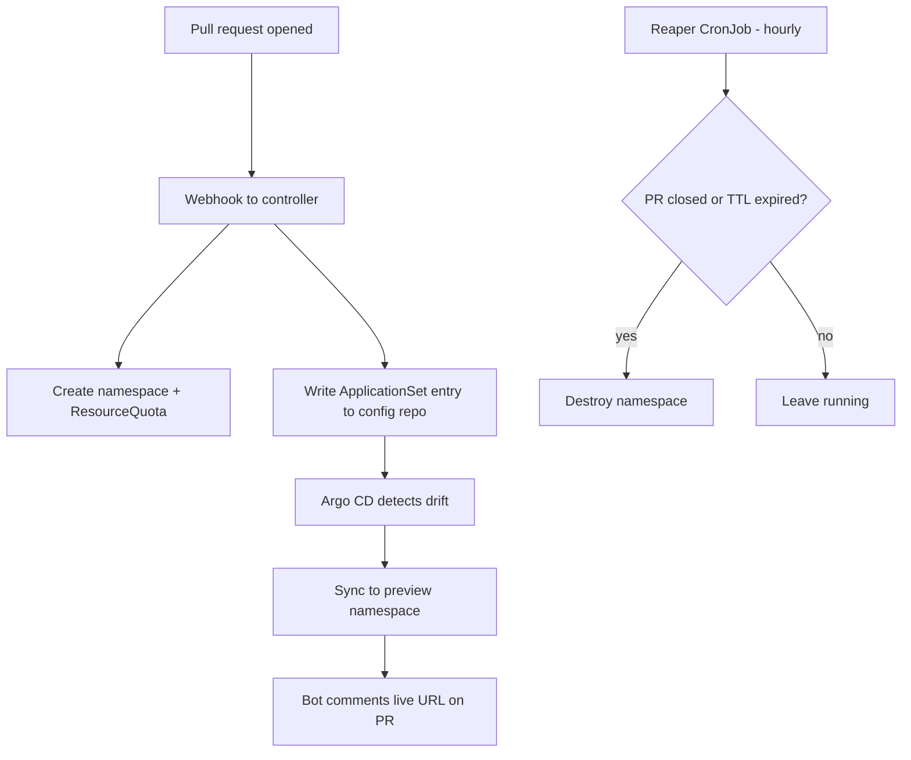

# Launchpad

**Every pull request gets its own live environment.**

Open a PR, and within a minute a bot comments a URL. Click it, and you're looking at
that branch running on Kubernetes — real cluster, real ingress, real database.
Close the PR, and everything it created disappears.

This is the Kubernetes equivalent of what Vercel and Netlify do for static sites, and
what Heroku Review Apps did before them. It exists because code review by reading a
diff is guesswork; code review by clicking the thing is not.

---

## The problem

A reviewer who wants to actually run a branch has to pull it, install dependencies,
run migrations, resolve a port conflict, and lose thirty minutes. Most don't. They
read the diff, write "LGTM", and merge.

Launchpad removes that cost entirely.

---

## How it works



Nothing in this flow runs `kubectl apply`. The controller writes to Git; Argo CD
reconciles the cluster against Git. That separation is the whole point.

---

## Architecture

### `launchpad-controller` — Go

Receives GitHub webhooks and manages environment lifecycle through `client-go`.

- Validates the webhook HMAC signature before doing anything
- Creates `preview-pr-<n>` namespace with a `ResourceQuota` (1 CPU, 1Gi memory)
  and a `LimitRange` so one noisy PR cannot starve the cluster
- Commits an `ApplicationSet` entry to the config repo
- Tears all of it down on `closed` and `merged` events

Go because `client-go` is the native Kubernetes SDK, and because a controller that
holds watch connections should not be fighting a GIL.

### `launchpad-reaper` — Python

A CronJob that runs hourly and answers one question: should this environment still
exist?

- Destroys environments older than their TTL (default 72h)
- Destroys environments whose PR has closed but whose teardown was missed
- Warns on the PR when an environment has had no traffic for 24h
- Exposes `/metrics` for Prometheus

Python because this is glue, scheduling, and GitHub API work — the things Python is
good at.

### `launchpad-config` — the GitOps repository

Helm chart, per-environment values, `ApplicationSet` definitions. The single source
of truth for cluster state.

---

## Design decisions

**Two repositories, not one.**
Application source lives in `launchpad`; deployment state lives in `launchpad-config`.
An application commit is not a deployment. Keeping them apart means cluster history
stays readable, and CI never needs cluster credentials — Argo CD pulls, CI does not push.

**Immutable image tags.**
Workloads are pinned to a commit SHA, never `:latest`. A pod that restarts three weeks
later pulls exactly the code that was deployed, not whatever happens to be tagged latest.

**Cleanup is a first-class feature.**
Creating environments is the easy half. Preview systems fail at reclaiming them —
someone opens a PR, goes on leave, and an environment runs for a month. Every
environment therefore carries a TTL, a `ResourceQuota`, and an automatic reaper.

**Least-privilege RBAC.**
The controller runs under a `ServiceAccount` scoped to namespace lifecycle operations.
Not `cluster-admin`. A compromised webhook handler should not be able to read every
secret in the cluster.

**Preview environments are isolated, not production clones.**
Each gets its own ephemeral Postgres with seed data. No shared database, no production
credentials, no sandbox keys that are quietly real.

---

## Stack

| Layer | Tool |
|---|---|
| Orchestration | Kubernetes (kind locally, k3s on EC2) |
| GitOps | Argo CD + ApplicationSet |
| Packaging | Helm |
| Containers | Docker, multi-stage, distroless base |
| Registry | Docker Hub |
| CI | GitHub Actions |
| Infrastructure | Terraform |
| Observability | Prometheus + Grafana |
| Services | Go, Python |

---

## Repository layout

    launchpad/
      controller/          # Go — webhook receiver, namespace lifecycle
      reaper/              # Python — TTL enforcement, PR bot
      .github/workflows/   # CI: test, build, scan, push, bump
      terraform/           # EC2 + k3s provisioning

    launchpad-config/      # separate repo
      charts/preview/      # Helm chart for a preview environment
      applicationsets/     # Argo CD ApplicationSet definitions
      apps/                # Long-lived applications

---

## Local setup

Requires Docker, kind, kubectl, and Helm.

```bash
# 1. Cluster
kind create cluster --name launchpad

# 2. Argo CD
kubectl create namespace argocd
kubectl apply -n argocd -f \
  https://raw.githubusercontent.com/argoproj/argo-cd/stable/manifests/install.yaml
kubectl -n argocd rollout status deploy/argocd-server

# 3. Admin password
kubectl -n argocd get secret argocd-initial-admin-secret \
  -o jsonpath="{.data.password}" | base64 -d

# 4. UI
kubectl -n argocd port-forward svc/argocd-server 8080:443
```

Argo CD is then at `https://localhost:8080`, username `admin`.

---

## Status

This is built in stages. Current state is honest, not aspirational.

| Stage | Status |
|---|---|
| Local cluster, Argo CD, working GitOps sync loop | Done |
| Helm chart with per-environment values | In progress |
| Controller: webhook, namespace lifecycle, quotas | Planned |
| ApplicationSet wiring, dynamic preview routing | Planned |
| Reaper + PR comment bot | Planned |
| CI pipeline: test, Trivy scan, build, tag bump | Planned |
| Terraform + k3s on EC2 | Planned |
| Prometheus, Grafana, alerting | Planned |

---

## What this project is really about

The application deployed into a preview environment is deliberately trivial. It is a
prop. The work is everything around it: the reconciliation loop, the isolation
boundaries, the quota enforcement, the teardown guarantees, the pipeline that gets a
commit from a laptop into a cluster without a human running a single command.

Building things is easy. Making sure they go away is engineering.
